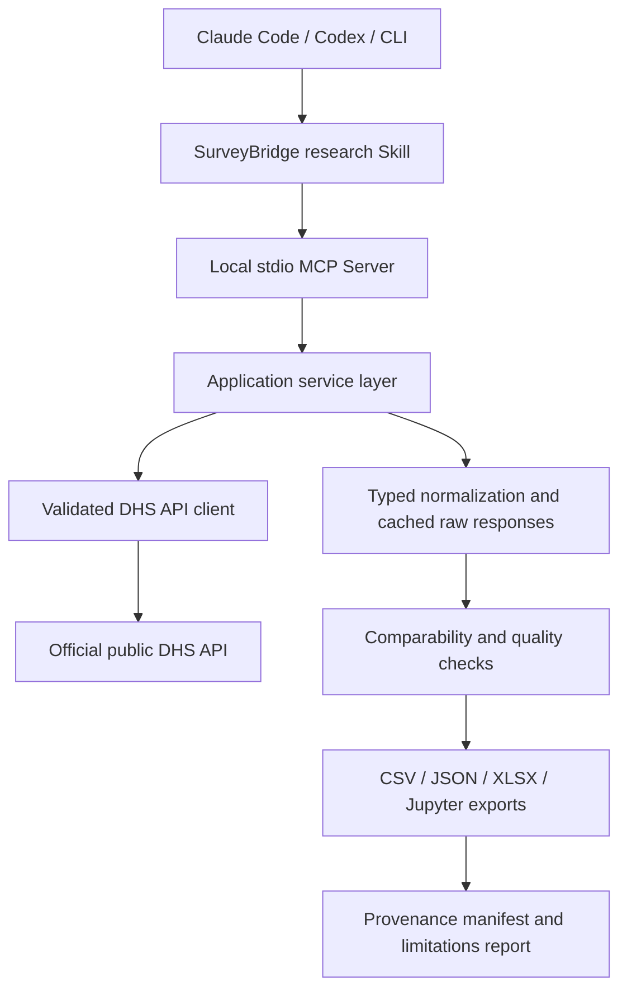

# SurveyBridge AI v0.1: Full Architecture

Owner: Quantium Insights LLC  
Status: build specification, not implemented software  
Goal: deliver a reproducible local-first MCP + Claude Code + Codex MVP in 14 focused development days.

## Product promise
Turn public DHS aggregated indicator data and survey metadata into reproducible cross-country and cross-round research projects. Discover surveys, identify official indicators, retrieve public observations, flag comparability risks, and export local notebooks and documented datasets. **Do not scrape protected DHS microdata or bypass access controls.**

## Architecture



### Layer contracts
1. **Interfaces:** `FastMCP` server over local stdio; equivalent Typer CLI. All business logic in application services.
2. **Data adapter:** `httpx` with API documentation verified at implementation time. Default base `https://api.dhsprogram.com/rest/dhs` if confirmed; configurable. Support actual API pagination and schemas, 429/5xx bounded retry, `Retry-After`, fixed timeouts, caching, source URLs, UTC retrieval time.
3. **Models:** Pydantic typed `Country`, `Survey`, `Indicator`, `Observation`, `ComparabilityFinding`, `ProvenanceManifest`.
4. **Scientific checks:** No silent imputation. Verify indicator IDs, units, disaggregation, populations, definitions, survey fieldwork year; flag unsupported comparisons. Surveys are repeated cross-sectional measurements, not continuous surveillance.
5. **Exports:** local CSV, JSON, Excel workbook, executable notebook, indicator dictionary, survey catalog, comparability report, limitations and provenance manifest with hashes.
6. **Safety:** DHS domain allowlist, local path controls, no credentials in logs, no arbitrary remote code execution, no remote telemetry, bounded pagination, privacy-conscious cache.

## MVP source restrictions
The DHS API exposes *aggregated indicators*. Dataset and microdata authorization is separate. Do not automatically download protected ZIP files, authenticate as the user, scrape gated pages, or redistribute restricted records. Do not promise all survey rounds have each indicator. The tool is independent from the DHS Program and must give source attribution.

## MCP tools (exact proposed names)
Every tool returns structured `{status,data,warnings,source,truncated}` with pagination details when needed.

| Tool | Inputs | Behavior |
|---|---|---|
| `surveybridge_healthcheck` | none | server/optional remote availability, version |
| `surveybridge_list_countries` | `query?`, `limit=100` | official country metadata and IDs |
| `surveybridge_list_surveys` | `country_ids[]`, `from_year?`, `to_year?` | survey rounds, dates and type |
| `surveybridge_search_indicators` | `query`, `limit=20` | official candidate indicators, exact identifiers |
| `surveybridge_get_indicator_series` | `indicator_id`, `country_ids[]`, `from_year?`, `to_year?`, `breakdown?` | public aggregated observations, with source lineage |
| `surveybridge_assess_comparability` | `project_id`, `indicator_ids?` | block/caution/info assessment using available metadata |
| `surveybridge_export_project` | `project_id`, `output_dir`, `formats[]` | documented reproducible project, safe local writes |

Validate actual API filter support before implementing parameters. Never infer indicator IDs from vague names without catalog lookup.

## Schema detail
**Observation:** source_country_id/name, source_survey_id, survey_year (nullable), indicator_id/label, value (nullable), unit (nullable), lower_ci/upper_ci (nullable), breakdown type/value (nullable), definition/denominator if provided, source_url, retrieved_utc, source_record_hash, warnings.

**ComparabilityFinding:** severity `info|caution|block`, affected keys, attribute, explanation, evidence, action recommendation. Shared indicator ID alone is *not* proof of full equivalence.

**ProvenanceManifest:** release version, git SHA, query filters, source endpoints, fetch dates, raw response hashes, source row IDs, output checksums, warnings and transformation history.

## Repository tree
```
surveybridge-ai/
├── ARCHITECTURE.md  PRD.md  ACCEPTANCE_TESTS.md
├── DATA_ACCESS_POLICY.md  CODEX_MASTER_PROMPT.md  README.md
├── AGENTS.md  pyproject.toml  .gitignore  LICENSE
├── src/surveybridge/
│   ├── cli.py  mcp_server.py  config.py  models.py
│   ├── clients/dhs.py
│   ├── services/catalog.py  services/series.py
│   ├── services/comparability.py  services/export.py
│   └── services/provenance.py  utils/cache.py
├── skills/surveybridge/SKILL.md
├── .agents/skills/surveybridge/SKILL.md
├── .claude-plugin/plugin.json  .mcp.json
├── .codex-plugin/plugin.json
├── tests/fixtures/  tests/test_dhs.py  tests/test_mcp.py
├── examples/four_country_immunization.md
└── .github/workflows/ci.yml
```

The plugin manifests above are targets. Codex must verify their exact current schemas with official docs before generating them. Use a canonical skill and CI check to avoid divergent skill copies.

## Dependencies
Python >=3.11, `httpx`, `pydantic`, `pandas`, `openpyxl`, `typer`, `mcp`, `nbformat`, `pytest`, `ruff`. Lock versions after installation and compatibility verification. Use stdio protocol output exclusively on stdout; diagnostics on stderr.

## Data flow
1. Resolve user-specified countries to API identifiers.
2. List available survey rounds and explicitly identify gaps.
3. Search exact indicator and validate population, unit and disaggregation.
4. Retrieve public aggregate series with bounded pagination and raw response snapshot.
5. Normalize data without inventing missing fields; deduplicate deterministically.
6. Run comparability checks; block unsupported comparisons.
7. Export outputs with full provenance and limitations.
8. Summarize only defensible descriptive observations, not causal effects.

## Outputs
`observations.csv`, `observations.json`, `survey_catalog.csv`, `indicator_dictionary.csv`, `comparability_report.json`, `comparability_report.md`, `limitations.md`, `provenance.json`, `analysis.ipynb`, `surveybridge_analysis.xlsx`, `README.md`.

## Explicit exclusions until v0.2+
Restricted microdata workflows, complex survey-weighted estimation from individual records, MICS, IPUMS extracts, routine DHIS2 surveillance, Bayesian forecasting, machine-generated significance tests, unauthorized bulk scraping, unreviewed causal interpretation.

## Release gates
Fresh install on Windows/macOS/Linux documented; deterministic test suite passes; live DHS test run documented; multi-country demo creates all outputs; MCP handshake works; source/metadata/provenance verified; no unauthorized data access; no fabricated numbers; warnings visible in artifacts and final summary.
